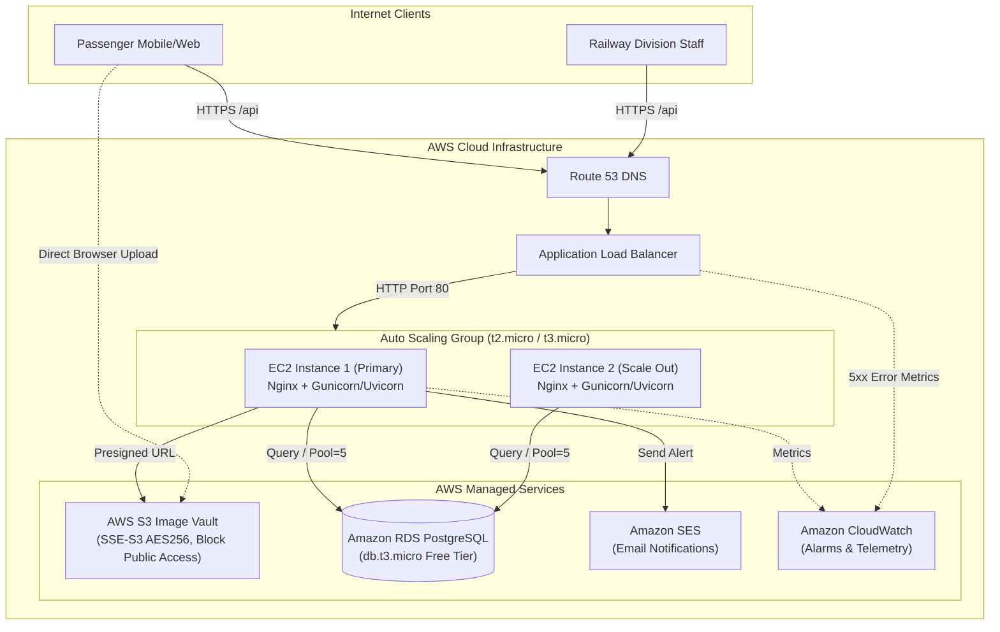

# RailAlert — AWS Infrastructure & DevOps Blueprint

This blueprint outlines the complete production-grade cloud architecture for **RailAlert** optimized for **AWS Free Tier (Direct Hosting - No Docker)** with high availability, automated scaling, least-privilege IAM controls, and proactive CloudWatch observability.

---

## 📐 High-Level Architecture Topology



---

## 1. EC2 Launch Template & Auto Scaling Group (ASG)

### Step 1.1: Create EC2 Launch Template (`railalert-lt`)
1. Navigate to **EC2 Console &rarr; Launch Templates &rarr; Create launch template**.
2. **Template Details**:
   - Name: `railalert-launch-template`
   - Description: `Production template for RailAlert direct-host EC2 instances`
3. **AMI**: Ubuntu Server 22.04 LTS (HVM), SSD Volume Type (`ami-03f4878e83d3e3188` in `ap-south-1` or latest).
4. **Instance Type**: `t2.micro` or `t3.micro` (AWS Free Tier eligible).
5. **Key Pair**: Select your production SSH key pair (e.g. `railalert-prod-key`).
6. **Network Settings**:
   - Security Group: `railalert-ec2-sg`
     - Inbound: Port 80 from `railalert-alb-sg` ONLY.
     - Inbound: Port 22 from Admin / Bastion IP address.
     - Outbound: All traffic (0.0.0.0/0).
7. **Storage (Volumes)**:
   - 1 x 20 GiB General Purpose SSD (`gp3`), encrypted with AWS default EBS key.
8. **IAM Instance Profile**: Select `RailAlertEC2InstanceRole` (contains S3 & SES least privilege policies).
9. **User Data (Bootstrap Script)**:
   ```bash
   #!/usr/bin/env bash
   set -e
   exec > >(tee /var/log/user-data.log|logger -t user-data -s 2>/dev/console) 2>&1

   echo "Starting RailAlert instance bootstrap..."
   cd /home/ubuntu
   git clone https://github.com/YOUR_ORG/railalert.git /home/ubuntu/railalert
   chown -R ubuntu:ubuntu /home/ubuntu/railalert
   bash /home/ubuntu/railalert/scripts/setup_ec2.sh
   echo "RailAlert bootstrap finished successfully."
   ```

---

### Step 1.2: Application Load Balancer (ALB) Setup
1. **Target Group (`railalert-tg`)**:
   - Target type: `Instances`
   - Protocol: `HTTP`, Port: `80`
   - Health Check Protocol: `HTTP`
   - Health Check Path: `/health`
   - Healthy threshold: `2`, Unhealthy threshold: `3`
   - Timeout: `5 seconds`, Interval: `30 seconds`
   - Success codes: `200`
2. **Load Balancer (`railalert-alb`)**:
   - Scheme: `Internet-facing`, IP address type: `IPv4`
   - VPC: Select Default or Custom VPC across at least 2 public subnets (`ap-south-1a`, `ap-south-1b`).
   - Security Group: `railalert-alb-sg` (Inbound: Port 80 and 443 from `0.0.0.0/0`).
   - Listeners:
     - `HTTP:80` &rarr; Forward to `railalert-tg` (or 301 Redirect to HTTPS 443).
     - `HTTPS:443` &rarr; Forward to `railalert-tg` with AWS Certificate Manager (ACM) SSL certificate.

---

### Step 1.3: Auto Scaling Group (`railalert-asg`)
1. **Capacity Limits**:
   - Minimum capacity: `1`
   - Desired capacity: `1` (Maintains Free Tier allowance)
   - Maximum capacity: `3` (Spikes during festival / train delays)
2. **Scaling Policies**:
   - Policy type: **Target Tracking Scaling Policy**
   - Metric: `Average CPU Utilization`
   - Target Value: `70%`
   - Warm-up period: `300 seconds`

---

## 2. AWS S3 Vault Security & Encryption Policies

The S3 bucket `railalert-vault-storage` stores photo evidence for complaints and lost items.

### Step 2.1: S3 Block Public Access (All Enabled)
Enable all 4 settings under **Block Public Access (bucket settings)**:
- [x] Block public access to buckets and objects granted through *new* access control lists (ACLs)
- [x] Block public access to buckets and objects granted through *any* access control lists (ACLs)
- [x] Block public access to buckets and objects granted through *new* public bucket or access point policies
- [x] Block public and cross-account access to buckets and objects through *any* public bucket or access point policies

---

### Step 2.2: S3 Bucket Policy (`s3-bucket-policy.json`)
Enforces **TLS 1.2+ encrypted transit** (`aws:SecureTransport: true`) and denies unencrypted object uploads:

```json
{
  "Version": "2012-10-17",
  "Statement": [
    {
      "Sid": "EnforceTLSRequestsOnly",
      "Effect": "Deny",
      "Principal": "*",
      "Action": "s3:*",
      "Resource": [
        "arn:aws:s3:::railalert-vault-storage",
        "arn:aws:s3:::railalert-vault-storage/*"
      ],
      "Condition": {
        "Bool": {
          "aws:SecureTransport": "false"
        }
      }
    },
    {
      "Sid": "DenyUnencryptedObjectUploads",
      "Effect": "Deny",
      "Principal": "*",
      "Action": "s3:PutObject",
      "Resource": "arn:aws:s3:::railalert-vault-storage/*",
      "Condition": {
        "StringNotEquals": {
          "s3:x-amz-server-side-encryption": "AES256"
        }
      }
    }
  ]
}
```

---

## 3. IAM Least-Privilege Policies

Attach the following policies to the EC2 Instance Role (`RailAlertEC2InstanceRole`) so no secret keys need to be stored on disk.

### 3.1: S3 Vault Access Policy (`RailAlert-S3-Policy`)
Permits presigned URL generation and object lifecycle management for complaints and lost items only:

```json
{
  "Version": "2012-10-17",
  "Statement": [
    {
      "Sid": "RailAlertS3BucketAccess",
      "Effect": "Allow",
      "Action": [
        "s3:ListBucket",
        "s3:GetBucketLocation"
      ],
      "Resource": "arn:aws:s3:::railalert-vault-storage"
    },
    {
      "Sid": "RailAlertS3ObjectOperations",
      "Effect": "Allow",
      "Action": [
        "s3:PutObject",
        "s3:GetObject",
        "s3:PutObjectTagging"
      ],
      "Resource": [
        "arn:aws:s3:::railalert-vault-storage/complaints/*",
        "arn:aws:s3:::railalert-vault-storage/lost-items/*"
      ]
    }
  ]
}
```

### 3.2: SES Transactional Alerts Policy (`RailAlert-SES-Policy`)
Permits sending grievance resolution confirmation emails from the authorized sender:

```json
{
  "Version": "2012-10-17",
  "Statement": [
    {
      "Sid": "RailAlertSESSendEmail",
      "Effect": "Allow",
      "Action": [
        "ses:SendEmail",
        "ses:SendRawEmail"
      ],
      "Resource": "*",
      "Condition": {
        "StringEquals": {
          "ses:FromAddress": "no-reply@railalert.internal"
        }
      }
    }
  ]
}
```

---

## 4. Amazon CloudWatch Monitoring & Alarms

Create these alarms using the AWS CLI or CloudWatch Console.

### 4.1: Alarm 1 &mdash; High CPU Utilization (`CPU > 80%`)
Alerts operations when the EC2 instance is experiencing high request volume or memory contention:

```bash
aws cloudwatch put-metric-alarm \
    --alarm-name "RailAlert-EC2-High-CPU" \
    --alarm-description "Triggers when RailAlert EC2 CPU utilization exceeds 80% for 5 minutes" \
    --metric-name CPUUtilization \
    --namespace AWS/EC2 \
    --statistic Average \
    --period 300 \
    --threshold 80 \
    --comparison-operator GreaterThanThreshold \
    --dimensions Name=AutoScalingGroupName,Value=railalert-asg \
    --evaluation-periods 2 \
    --alarm-actions "arn:aws:sns:ap-south-1:123456789012:railalert-devops-alerts"
```

### 4.2: Alarm 2 &mdash; Target Group 5xx HTTP Errors (`HTTP 5XX >= 5`)
Alerts when FastAPI or Gunicorn backend returns 5xx server exceptions:

```bash
aws cloudwatch put-metric-alarm \
    --alarm-name "RailAlert-ALB-Target-5XX-Errors" \
    --alarm-description "Triggers if RailAlert Target Group registers 5 or more 5XX errors in 1 minute" \
    --metric-name HTTPCode_Target_5XX_Count \
    --namespace AWS/ApplicationELB \
    --statistic Sum \
    --period 60 \
    --threshold 5 \
    --comparison-operator GreaterThanOrEqualToThreshold \
    --dimensions Name=TargetGroup,Value=targetgroup/railalert-tg/1234567890123456 \
    --evaluation-periods 1 \
    --alarm-actions "arn:aws:sns:ap-south-1:123456789012:railalert-devops-alerts"
```

### 4.3: Alarm 3 &mdash; Unhealthy Instance Count (`UnhealthyHosts >= 1`)
Alerts if an instance fails `/health` check:

```bash
aws cloudwatch put-metric-alarm \
    --alarm-name "RailAlert-ALB-Unhealthy-Host" \
    --alarm-description "Triggers if an instance in the target group fails health checks" \
    --metric-name UnHealthyHostCount \
    --namespace AWS/ApplicationELB \
    --statistic Maximum \
    --period 60 \
    --threshold 1 \
    --comparison-operator GreaterThanOrEqualToThreshold \
    --dimensions Name=TargetGroup,Value=targetgroup/railalert-tg/1234567890123456 \
    --evaluation-periods 1 \
    --alarm-actions "arn:aws:sns:ap-south-1:123456789012:railalert-devops-alerts"
```
